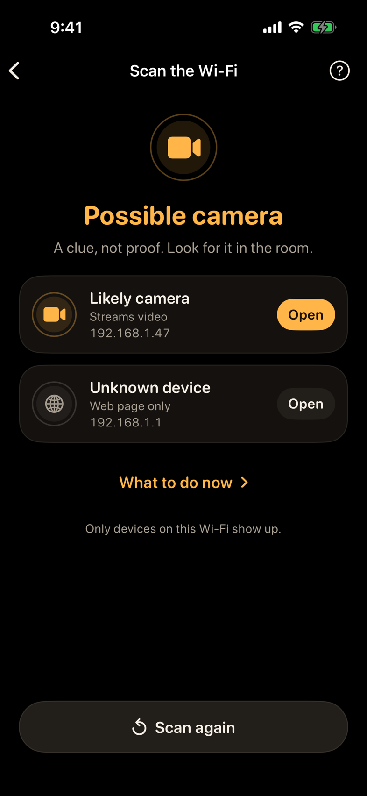
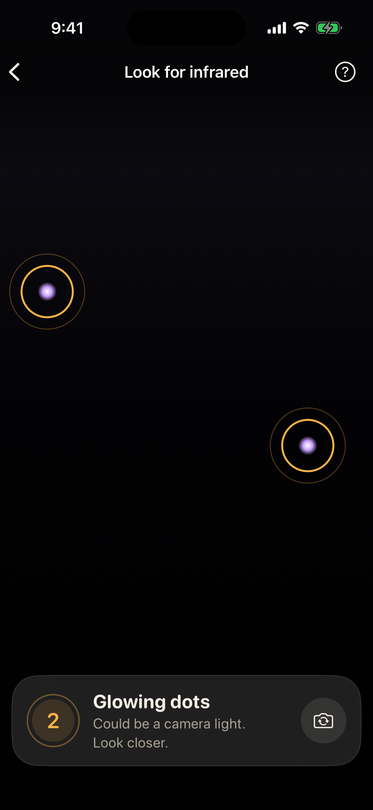
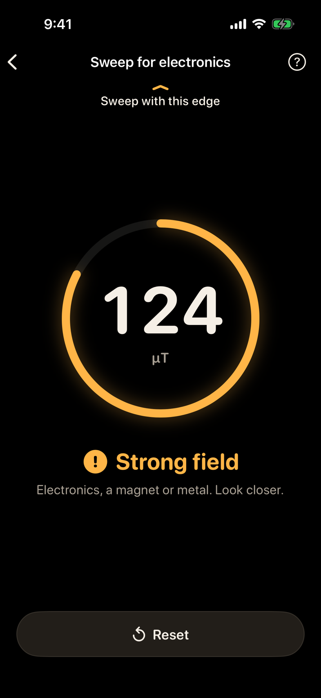
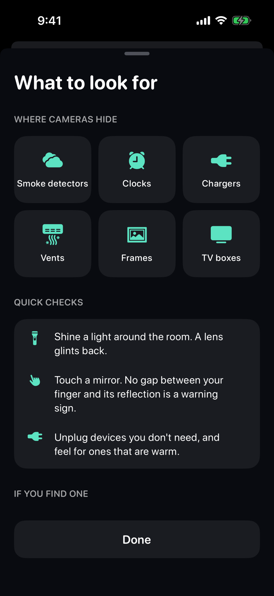

# CamSweep — App iOS phát hiện camera ẩn

App iOS đơn giản giúp bạn kiểm tra phòng khách sạn / Airbnb xem có camera quay lén hay không. Không cần server, không tài khoản, không thu thập dữ liệu — mọi thứ chạy trên máy.

<p align="center">
  
  
  
  
  
</p>

<p align="center"><em>Ảnh chụp từ iOS Simulator, dùng dữ liệu mẫu.</em></p>

## Cách dùng

Trang chủ liệt kê ba bước kiểm tra theo thứ tự nên làm. Mỗi bước mở một màn hình riêng chỉ có một việc; nút **?** ở góc trên giải thích cách làm.

### 1. Scan the Wi-Fi — quét mạng

Kết nối Wi-Fi của phòng rồi bấm **Start scan**. App dò mọi địa chỉ trong mạng để tìm thiết bị đang phát video (giao thức RTSP mà hầu hết camera IP dùng).

- Lần đầu iOS hỏi quyền **Local Network** — cần đồng ý; app chờ bạn trả lời rồi mới quét.
- **Possible camera**: có thiết bị đang phát video trong mạng — gần như chắc chắn là camera.
- Thiết bị chỉ có trang web (router, TV, máy in… hoặc camera): chạm vào để mở trang của nó xem là gì.
- **Giới hạn:** nhiều khách sạn chặn thiết bị nhìn thấy nhau, và camera ghi thẻ nhớ / dùng SIM riêng thì không hiện. Kết quả trống *không* có nghĩa phòng sạch.

### 2. Look for infrared — tìm đèn hồng ngoại

Camera quay đêm có đèn LED hồng ngoại: mắt thường không thấy, nhưng camera điện thoại thấy (thành đốm sáng).

- **Tắt hết đèn, kéo rèm.** App báo "Too bright" nếu phòng chưa đủ tối.
- Lia máy chậm quanh phòng; app tự khoanh đỏ các đốm sáng.
- Tự kiểm chứng: chĩa remote TV vào camera rồi bấm nút — đầu remote phải nháy sáng trên màn hình.
- Đổi sang camera sau và bật đèn pin để soi **phản xạ ống kính** (ống kính camera hắt lại một chấm sáng nhỏ).

### 3. Sweep for electronics — dò từ trường

Đồ điện tử và nam châm làm nhiễu từ trường ở khoảng cách rất gần (2–5 cm).

- Đứng giữa phòng, bấm **Reset** để lấy mốc.
- Đưa **cạnh trên** của máy dọc theo các vật khả nghi: đầu báo khói, đồng hồ, củ sạc, khe gió, khung ảnh.
- Số vọt lên đột ngột (máy rung khi rất mạnh) = bên trong có đồ điện tử hoặc nam châm. Kim loại, loa, TV cũng gây ra — đó là manh mối, chưa phải bằng chứng.

### What to look for by hand — kiểm tra bằng tay

Những chỗ camera hay được giấu, ba phép thử nhanh (soi đèn pin, thử gương, rút điện), và việc cần làm nếu phát hiện camera: không chạm vào, che lại rồi chụp ảnh, đổi phòng và báo công an.

## Build & cài lên iPhone

Cần macOS với **Xcode 16 trở lên** và một **iPhone thật** chạy iOS 17+ (simulator không có camera, từ kế hay Wi-Fi thật).

1. Mở `ios/CamSweep.xcodeproj` bằng Xcode.
2. Chọn target **CamSweep** → **Signing & Capabilities** → chọn **Team** của bạn. Nếu trùng bundle ID, đổi `com.example.camsweep` thành chuỗi riêng.
3. Cắm iPhone, chọn nó làm thiết bị chạy, bấm **Run** (⌘R).
4. Lần đầu: trên iPhone vào *Settings → General → VPN & Device Management* và tin tưởng (Trust) developer profile của bạn.

## Build tự động và ảnh chụp

`.github/workflows/ios-build.yml` build app cho simulator mỗi khi thư mục `ios/` thay đổi, nên lỗi biên dịch lộ ra ngay cả khi không có Xcode trong tay.

Chạy workflow đó bằng tay (*Actions → iOS build → Run workflow*) để chụp lại ảnh: nó mở từng màn hình với dữ liệu mẫu trong simulator và commit ảnh vào `ios/screenshots`. Trên máy Mac có thể chạy trực tiếp:

```sh
ios/scripts/build.sh
ios/scripts/screenshots.sh ios/build/Debug-iphonesimulator/CamSweep.app ios/screenshots home wifi infrared magnetic guide
```

## Mã nguồn

| File | Vai trò |
| --- | --- |
| `HomeView.swift` | Trang chủ: ba bước kiểm tra và lối vào phần hướng dẫn |
| `WiFiView.swift` · `WiFiScanner.swift` | Màn quét Wi-Fi · xin quyền Local Network, dò cổng, tìm dịch vụ video |
| `InfraredView.swift` · `InfraredScanner.swift` | Màn camera · phân tích khung hình tìm đốm sáng |
| `MagneticView.swift` · `MagneticSensor.swift` | Màn đo từ trường · đọc từ kế, lấy mốc, phân mức |
| `GuideView.swift` | Hướng dẫn kiểm tra bằng tay |
| `Theme.swift` | Màu sắc và các thành phần dùng chung |
| `Demo.swift` | Chế độ dữ liệu mẫu để chụp ảnh (`-demoScreen <tên>`) |

## Giới hạn trung thực

Không app nào bảo đảm phòng không có camera. CamSweep giúp bắt các loại camera rẻ tiền phổ biến; camera đi dây, không hồng ngoại, không nối mạng và giấu kỹ có thể lọt qua mọi phép thử. Hãy kết hợp cả ba bước với việc tự quan sát, và báo cơ quan chức năng nếu thực sự nghi ngờ.

Phần camera, từ kế và quét mạng cần iPhone thật để chạy; build tự động chỉ xác nhận app biên dịch được và các màn hình hiển thị đúng với dữ liệu mẫu.
