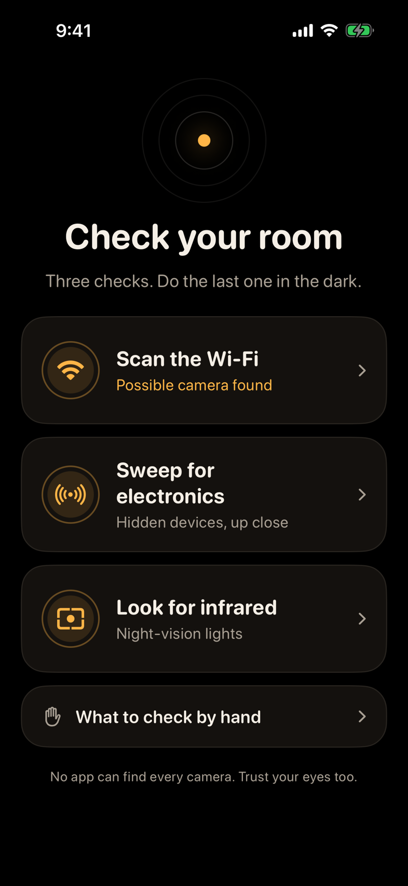

# CamSweep — App iOS phát hiện camera ẩn

App iOS đơn giản giúp bạn kiểm tra phòng khách sạn / Airbnb xem có camera quay lén hay không. Không cần server, không tài khoản, không thu thập dữ liệu — mọi thứ chạy trên máy.

<p align="center">
  
  
  
  
  
</p>

<p align="center"><em>Ảnh chụp từ iOS Simulator, dùng dữ liệu mẫu.</em></p>

## Cách dùng

Trang chủ liệt kê ba bước kiểm tra theo thứ tự nên làm: hai bước đầu làm khi còn bật đèn, bước cuối cần phòng tối. Mỗi bước mở một màn hình chỉ có một việc; nút **?** ở góc trên giải thích cách làm trong ba dòng.

Giao diện chỉ có nền đen và một màu nhấn hổ phách — màu đó luôn có nghĩa "hãy nhìn vào đây". App không dùng màu xanh "an toàn" ở đâu cả, vì không kết quả nào của nó có nghĩa là phòng sạch: mọi phát hiện là **manh mối, không phải bằng chứng**.

### 1. Scan the Wi-Fi — quét mạng

Kết nối Wi-Fi của phòng rồi bấm **Start scan**. App dò các địa chỉ quanh máy bạn trong mạng (tối đa 1022 địa chỉ) để tìm thiết bị đang phát video — giao thức RTSP mà hầu hết camera IP dùng.

- Lần đầu iOS hỏi quyền **Local Network**; app chờ bạn trả lời rồi mới quét. Nếu quyền bị tắt, app nói rõ điều đó thay vì báo "không thấy gì".
- **Possible camera**: có thiết bị đang phát video. Bấm **What to do now** để xem nên làm gì.
- **Unknown device**: thiết bị chỉ có trang web (router, TV, máy in… hoặc camera). Bấm **Open** để mở trang của nó xem là gì.
- Kết quả được giữ lại khi bạn quay về trang chủ; bấm **Cancel** giữa chừng thì không có kết luận nào được hiển thị.
- **Giới hạn:** nhiều khách sạn chặn thiết bị nhìn thấy nhau, và camera ghi thẻ nhớ / dùng SIM riêng thì không hiện. Kết quả trống *không* có nghĩa phòng sạch.

### 2. Sweep for electronics — dò từ trường

Đồ điện tử và nam châm làm nhiễu từ trường ở khoảng cách rất gần (2–5 cm).

- Đứng giữa phòng, bấm **Reset** để lấy mốc. Lúc mới mở, app cần vài giây "Calibrating" — hãy di chuyển máy nhẹ nhàng.
- Đưa **cạnh trên** của máy (mũi tên trên màn hình chỉ vào đó) dọc theo các vật khả nghi: đầu báo khói, đồng hồ, củ sạc, khe gió, khung ảnh.
- Số vọt lên và vòng đo chuyển màu hổ phách (máy rung khi rất mạnh) = bên trong có đồ điện tử, nam châm hoặc kim loại. Loa và TV cũng gây ra — đó là manh mối.

### 3. Look for infrared — tìm đèn hồng ngoại

Camera quay đêm có đèn LED hồng ngoại: mắt thường không thấy, nhưng camera trước của điện thoại thấy (thành đốm sáng).

- **Tắt hết đèn, kéo rèm.** Nếu phòng còn sáng, app báo "Too bright" và tự làm tối màn hình để không rọi sáng căn phòng.
- Lia máy chậm quanh phòng; app khoanh vòng quanh mỗi đốm sáng và đếm số đốm.
- Tự kiểm chứng: chĩa remote TV vào camera rồi bấm nút — đầu remote phải nháy sáng trên màn hình.
- Đổi sang camera sau và bật đèn pin để soi **phản xạ ống kính**: ống kính camera hắt lại một chấm sáng nhỏ. (Camera sau lọc mất hồng ngoại nên chỉ dùng cho phép thử này.)

### What to check by hand — kiểm tra bằng tay

Ba trang ngắn: những chỗ camera hay được giấu, bốn phép thử nhanh (soi đèn pin, thử gương, rút điện, thử remote), và việc cần làm nếu phát hiện camera — không chạm vào, che lại rồi chụp ảnh, đổi phòng, báo công an.

## Build & cài lên iPhone

Cần macOS với **Xcode 16 trở lên** và một **iPhone thật** chạy iOS 17+ (simulator không có camera, từ kế hay Wi-Fi thật).

1. Mở `ios/CamSweep.xcodeproj` bằng Xcode.
2. Chọn target **CamSweep** → **Signing & Capabilities** → chọn **Team** của bạn. Nếu trùng bundle ID, đổi `com.example.camsweep` thành chuỗi riêng.
3. Cắm iPhone, chọn nó làm thiết bị chạy, bấm **Run** (⌘R).
4. Lần đầu: trên iPhone vào *Settings → General → VPN & Device Management* và tin tưởng (Trust) developer profile của bạn.

## Build tự động và ảnh chụp

`.github/workflows/ios-build.yml` build app cho simulator mỗi khi thư mục `ios/` thay đổi, nên lỗi biên dịch lộ ra ngay cả khi không có Xcode trong tay.

Chạy workflow đó bằng tay (*Actions → iOS build → Run workflow*) để chụp lại ảnh: nó mở từng màn hình với dữ liệu mẫu trong simulator và commit ảnh vào `ios/screenshots`. Trên máy Mac có thể chạy trực tiếp:

```sh
ios/scripts/build.sh
ios/scripts/screenshots.sh ios/build/Debug-iphonesimulator/CamSweep.app ios/screenshots home wifi magnetic infrared guide
```

## Mã nguồn

| File | Vai trò |
| --- | --- |
| `HomeView.swift` | Trang chủ: ba bước kiểm tra và lối vào phần kiểm tra bằng tay |
| `WiFiView.swift` · `WiFiScanner.swift` | Màn quét Wi-Fi · xin quyền Local Network, dò cổng, tìm dịch vụ video |
| `MagneticView.swift` · `MagneticSensor.swift` | Màn đo từ trường · đọc từ trường đã hiệu chuẩn, lấy mốc, phân mức |
| `InfraredView.swift` · `InfraredScanner.swift` | Màn camera · phân tích khung hình tìm đốm sáng |
| `GuideView.swift` | Kiểm tra bằng tay |
| `Theme.swift` | Màu sắc và các thành phần dùng chung (vòng halo, vòng đo, nút) |
| `Demo.swift` | Chế độ dữ liệu mẫu để chụp ảnh (`-demoScreen <tên>`) |

## Giới hạn trung thực

Không app nào bảo đảm phòng không có camera. CamSweep giúp bắt các loại camera rẻ tiền phổ biến; camera đi dây, không hồng ngoại, không nối mạng và giấu kỹ có thể lọt qua mọi phép thử. Hãy kết hợp cả ba bước với việc tự quan sát, và báo cơ quan chức năng nếu thực sự nghi ngờ.

Phần camera, từ kế và quét mạng cần iPhone thật để chạy; build tự động chỉ xác nhận app biên dịch được và các màn hình hiển thị đúng với dữ liệu mẫu. Ngưỡng cảnh báo của từ kế (30 / 100 µT) chưa được đo trên máy thật và có thể cần chỉnh.
